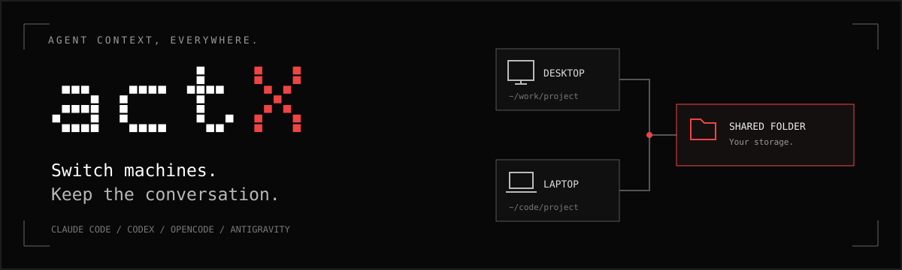
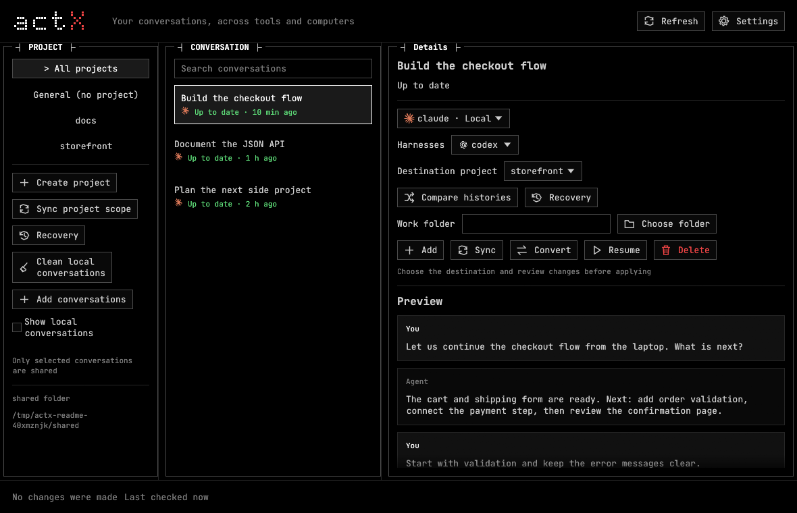

<p align="center">
  
</p>

<p align="center">
  <a href="https://github.com/ericpastorm/actx/actions/workflows/test.yml"></a>
  <a href="LICENSE"></a>
  
  
</p>

<p align="center">
  <strong>English</strong> · <a href="README.es.md">Español</a> · <a href="README.zh-CN.md">简体中文</a>
</p>

<p align="center">
  <a href="#install">Install</a> · <a href="#from-desktop-to-laptop">Get started</a> · <a href="docs/desktop.md">Desktop guide</a> · <a href="docs/cli.md">CLI guide</a> · <a href="docs/json-api.md">JSON API</a>
</p>

# Your agent context, everywhere

**actX syncs and converts coding-agent conversations.** Start with Claude Code on your desktop,
continue with Codex on your laptop, or open the same work in opencode. Keep the context you already
built, with a native desktop interface or a compact terminal browser.

Choose the conversations to share and the storage to carry them: a NAS, a network share,
Syncthing, Dropbox or another shared folder. Each computer keeps its own project paths and agent preferences.

## What you can do

| You want to… | actX handles… |
| --- | --- |
| **Continue on another computer** | Two-way sync, repository matching and path rewriting when projects live in different folders. |
| **Switch agents** | Conversion between Claude Code, Codex, opencode and Antigravity CLI, including local conversations outside a project. |
| **Choose what gets shared** | Named projects, General conversations and explicit selection. Optional project rules add new matches with exclusions. |
| **Use a GUI or a terminal** | Search, project filters, message previews, copy states and opening a conversation in your chosen agent. |
| **Maintain several agent copies** | Per-computer profiles, linked copies and propagation of complete continuations, reusing existing sessions. |
| **Review a conflict** | History comparison, reviewed resolution and preserved alternatives. Backups and recovery include interrupted publications. |
| **Tidy up local history** | Review old, short, repeated or agent-created conversations and move selected entries to recoverable quarantine. |
| **Automate the routine** | Opt-in Claude Code/Codex hooks, a periodic sync timer and project adoption rules. Unresolved decisions wait for review. |
| **Build your own workflow** | A versioned JSON API for listing, previews, sync, conversion, cleanup and recovery. |

## A desktop when you want it



*Native Linux desktop with example conversations. The CLI is available from the same installation.*

1. **Choose a project or General.** Browse maintained conversations, or show local ones to add them.
2. **Choose a conversation and agent.** Inspect messages, local/shared copies and the destination folder.
3. **Review and apply.** Sync, convert, resume, resolve a conflict or recover a previous version.

The desktop also includes cleanup, automatic-addition rules, settings and diagnostics. A local catalog
opens first and refreshes in the background; message history loads on selection. The Pixel 5×7
wordmark has an animated red X, with local appearance controls in Settings.

## Install

Install [Rust](https://rustup.rs), Git and [fzf](https://github.com/junegunn/fzf), plus the agents you
want to use. fzf powers the interactive terminal pickers.

**With the desktop:**

```sh
cargo install --git https://github.com/ericpastorm/actx --features gui --locked
actx gui
```

This installs `actx` and the `actx-gui` launcher. Open `actx-gui` directly to use it without a terminal;
keep both executables together if copying the installation manually.

**CLI only:**

```sh
cargo install --git https://github.com/ericpastorm/actx --locked
actx setup
```

**CLI:** CI covers Linux, macOS and Windows. **Desktop preview:** checked natively on Linux;
Windows/macOS windows, folder dialogs and terminal launches still need hands-on validation.
See [installation requirements](docs/cli.md#install) and the [desktop guide](docs/desktop.md).

## From desktop to laptop

On your first computer:

```sh
actx setup                  # choose shared storage and the agents to maintain here
cd ~/work/shop
actx mk shop                # bind this folder and choose conversations
actx sync shop              # publish changes and update linked copies
```

On your other computer:

```sh
actx setup                  # same shared storage; this computer's agent preferences
actx sync shop              # find the repository or choose its local folder
actx resume shop            # select a conversation and continue in an agent
```

The project can live at `~/work/shop` on one computer and `D:\Projects\shop` on another.
actX matches repositories, rewrites conversation paths and remembers the destination you choose.
**Your code travels through Git or your existing workflow; actX carries the conversations.**

Run `actx` for the compact browser. Its normal view shows maintained conversations;
`actx --all` includes the rest of your local inventory.

## Conversations without a project

Save selected conversations in **General**, then choose their destination folders on another computer:

```sh
actx add --general
actx sync --general
```

Each conversation remembers its own destination on each computer. Conversion also works locally
without shared storage, an actX project or a Git repository:

```sh
actx cv --all
```

## Supported agents

| Agent | Shared native sync | Conversion | Local linked copies |
| --- | :---: | :---: | :---: |
| Claude Code | ✓ | ✓ | ✓ |
| Codex | ✓ | ✓ | ✓ |
| opencode 1.x / 2.x | ✓ | ✓ | ✓ |
| Antigravity CLI (`agy`) | — | ✓ | ✓ |

To share a conversation that starts in Antigravity, convert it into one of the three native sync
agents first. Antigravity currently participates through conversion and local linked copies.

Conversion keeps user messages and assistant replies. Tool calls become text; images, internal
reasoning and history preceding a compaction are not fully carried across. opencode version changes
can also require conversion. See [conversion details](docs/cli.md#converting-between-tools).

## Commands at a glance

| Command | Purpose |
| --- | --- |
| `actx gui` | Open the optional desktop interface. |
| `actx` / `actx ls` | Browse maintained conversations / print their state. |
| `actx mk <project>` / `actx rm <project>` | Create or remove an actX project. |
| `actx add` / `actx delete` | Select conversations to share or remove from shared storage. Keep local originals. |
| `actx sync` / `actx sync --dry-run` | Synchronize or inspect proposed operations. |
| `actx resume` / `actx cv --all` | Continue a conversation / convert one into another agent. |
| `actx compare` / `actx resolve` | Compare histories and review a conflict resolution. |
| `actx recoveries` / `actx restore` | Browse recoverable versions / restore a backup. |
| `actx clean` / `actx clean advanced` | Review local cleanup candidates and quarantine selected entries. |
| `actx auto on` / `actx auto off` | Enable or disable hooks and periodic synchronization. |
| `actx auto-add <project>` | Configure optional project discovery rules and exclusions. |
| `actx profile setup` / `actx doctor` | Set this computer's preferences / diagnose the installation. |

The [CLI guide](docs/cli.md) covers scopes, retention, completions, updates and command options.

## Review, recovery and your storage

actX tracks previous syncs to distinguish uploads, downloads and conflicts. It checks conversation
identity and activity before writing, backs up replaced local histories and uses locks and atomic
publication in shared storage. Independent edits stay visible for resolution; verified extensions
of a synchronized reply can continue without duplicating the original prompt.

Cleanup moves selected conversations into quarantine and protects shared, linked and detected active
copies. Recovery also exposes recognized remnants of interrupted shared publications. Optional
retention removes eligible **shared** copies while keeping local originals and projects.

Your shared folder contains conversation data, including prompts and command output. Keep it private:
transcripts can contain credentials or other sensitive content. With delayed folder-sync tools,
avoid simultaneous writes to the same project; see [storage details](docs/cli.md#the-shared-folder).

## Documentation

| Guide | What's inside |
| --- | --- |
| [CLI guide](docs/cli.md) · [Guía en español](docs/cli.es.md) | Installation, commands, profiles, General, automation, conversion and storage. |
| [Desktop guide](docs/desktop.md) | GUI workflows, catalog caching, recovery and platform checks. |
| [JSON API](docs/json-api.md) | Actions, previews, revisions, confirmation, states and exit codes. |
| [Changelog](CHANGELOG.md) | Implemented changes and compatibility limits. |
| [Development](docs/cli.md#development) | Local checks, integration fixtures and the CI matrix. |

actX reads native formats that can change with agent releases. The
[CLI guide](docs/cli.md#limitations) documents format and platform limits.

[MIT](LICENSE). Independent project. Agent logos belong to their respective owners;
see [artwork sources](assets/harnesses/README.md).
